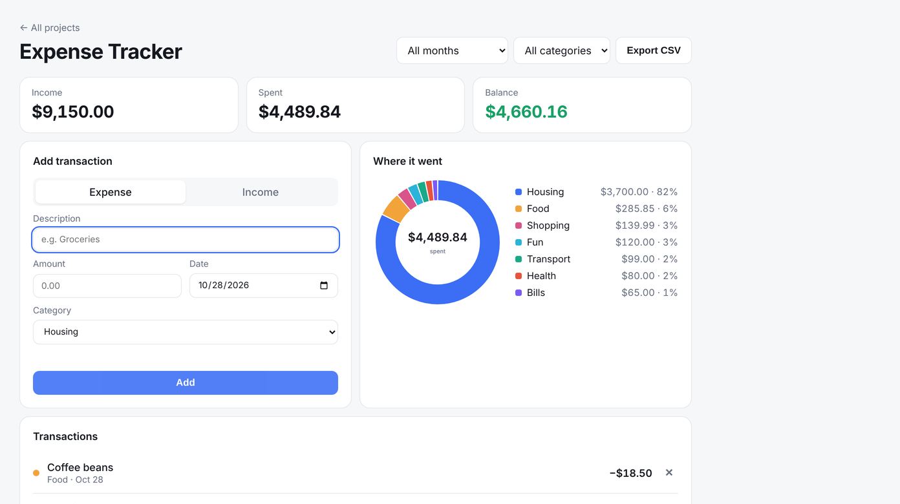

# 💸 Expense Tracker



Log income and expenses, filter by month and category, and see where the money goes.

- **Discriminated union** types: an `income` can't have an expense category, and the compiler enforces it
- Money stored as **integer cents** to avoid floating-point rounding errors
- Donut chart drawn by hand on `<canvas>` (no chart library), sharp on high-DPI screens
- Data loaded from `localStorage` is validated at runtime with a type guard
- CSV export with proper escaping

**Skills:** type modeling, data aggregation, Canvas API, input validation

## Run it

You need [Node.js](https://nodejs.org/) installed. Then, in this folder:

```bash
npm install     # installs TypeScript
npm start       # compiles the code and opens a local server
```

Open the link it prints (usually http://localhost:3000).

Other commands:

```bash
npm test        # run the unit tests
npm run watch   # recompile automatically while you edit
```

> Opening `index.html` directly by double-clicking won't work. Browsers block JavaScript modules on `file://`, so use `npm start`.

## Built with

TypeScript (strict mode), HTML and CSS. No frameworks or libraries.
