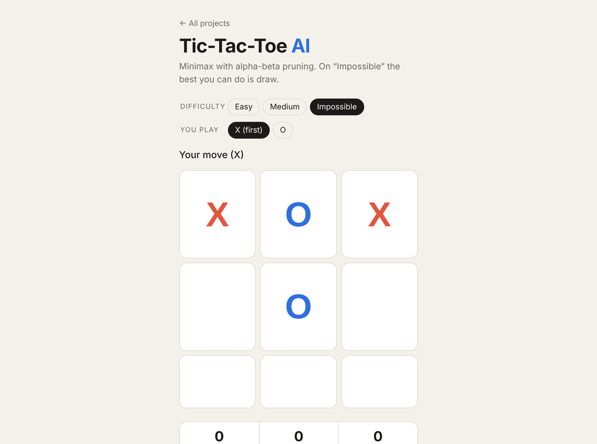

# ❌⭕ Tic-Tac-Toe AI



Play against an AI that uses **minimax with alpha-beta pruning**. On *Impossible* it never loses, and a test proves it by playing out every possible game.

- Three difficulty levels (Easy plays randomly, Medium mixes random and perfect moves)
- Play as X or O, with a scoreboard saved in `localStorage`
- Game logic kept separate from the UI (`game.ts` has no DOM code) so it's unit-tested

**Skills:** recursion, game trees, pruning, separating logic from UI

## Run it

You need [Node.js](https://nodejs.org/) installed. Then, in this folder:

```bash
npm install     # installs TypeScript
npm start       # compiles the code and opens a local server
```

Open the link it prints (usually http://localhost:3000).

Other commands:

```bash
npm test        # run the unit tests
npm run watch   # recompile automatically while you edit
```

> Opening `index.html` directly by double-clicking won't work. Browsers block JavaScript modules on `file://`, so use `npm start`.

## Built with

TypeScript (strict mode), HTML and CSS. No frameworks or libraries.
