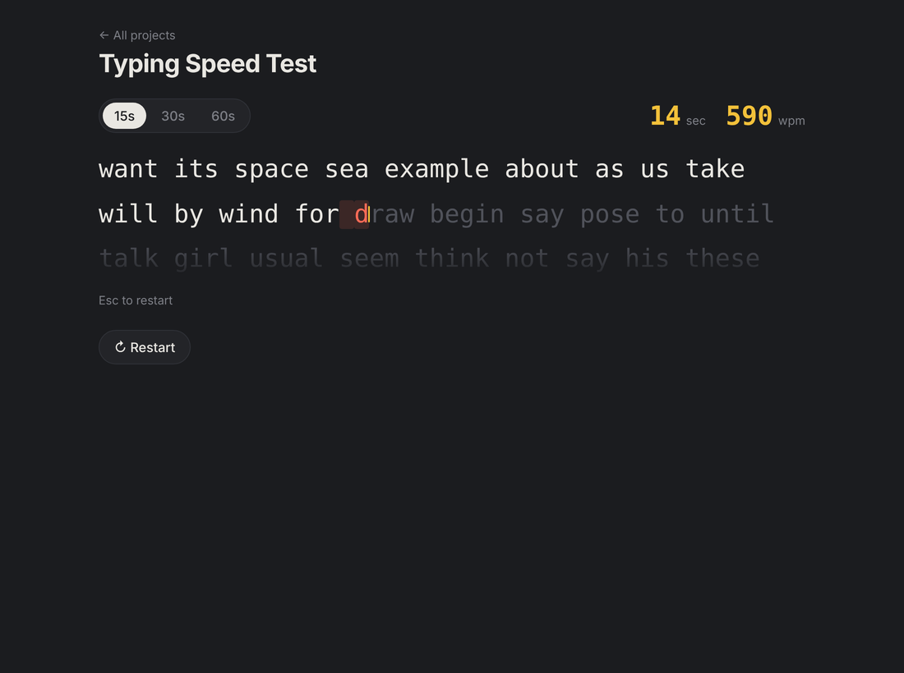

# ⌨️ Typing Speed Test



A timed typing test with per-character feedback.

- 15 / 30 / 60-second modes, live WPM, accuracy and a personal best per mode
- Accuracy counts mistakes even if you fix them later, like real typing tests
- Text scrolls line by line to follow the caret
- Uses a hidden input, so it works with mobile keyboards too

**Skills:** real-time rendering, timers, event handling, scoring logic

## Run it

You need [Node.js](https://nodejs.org/) installed. Then, in this folder:

```bash
npm install     # installs TypeScript
npm start       # compiles the code and opens a local server
```

Open the link it prints (usually http://localhost:3000).

Other commands:

```bash
npm test        # run the unit tests
npm run watch   # recompile automatically while you edit
```

> Opening `index.html` directly by double-clicking won't work. Browsers block JavaScript modules on `file://`, so use `npm start`.

## Built with

TypeScript (strict mode), HTML and CSS. No frameworks or libraries.
