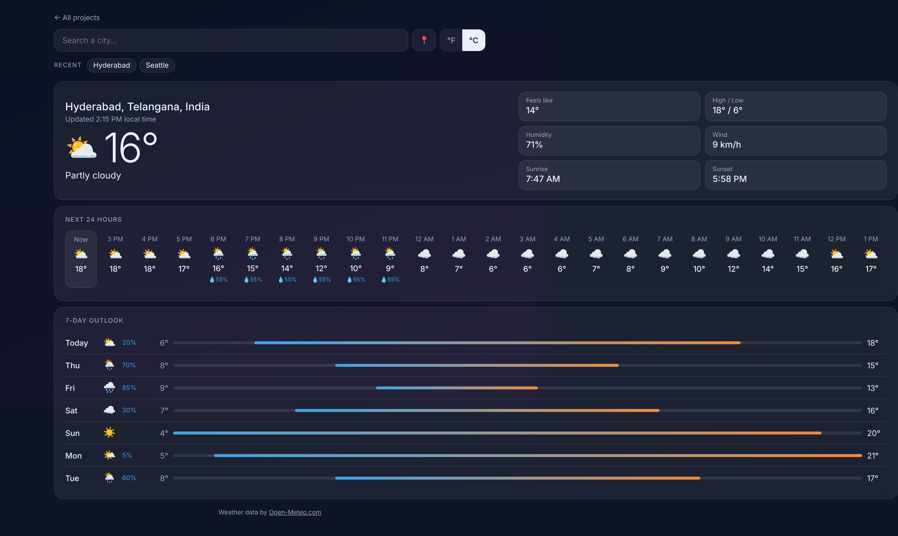

# ⛅ Weather Dashboard



Search any city for current conditions, the next 24 hours and a 7-day outlook, using the free [Open-Meteo](https://open-meteo.com/) API (no API key needed).

- Autocomplete search with **debouncing** and keyboard navigation (↑ ↓ Enter Esc)
- `AbortController` cancels stale requests so fast typing never shows the wrong city
- Typed API client, loading and error states, °F / °C toggle, "use my location"
- Week temperature range bars, recent searches saved locally

**Skills:** async/await, Fetch API, race conditions, accessible combobox

## Run it

You need [Node.js](https://nodejs.org/) installed. Then, in this folder:

```bash
npm install     # installs TypeScript
npm start       # compiles the code and opens a local server
```

Open the link it prints (usually http://localhost:3000).

Other commands:

```bash
npm test        # run the unit tests
npm run watch   # recompile automatically while you edit
```

> Opening `index.html` directly by double-clicking won't work. Browsers block JavaScript modules on `file://`, so use `npm start`.

## Built with

TypeScript (strict mode), HTML and CSS. No frameworks or libraries.
